
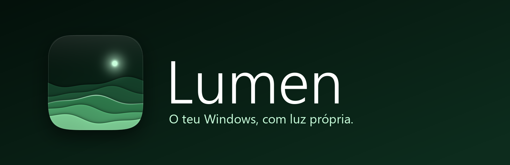

  
  
  
  
  

  <a href="README.md">Português</a> · <b>English</b> · <a href="README.es.md">Español</a>

<h3 align="center">A glass bar, a wallpaper that counts the hours and useful panels on the desktop itself. Install it, pick a theme, and your PC becomes something else. One click takes you back to plain Windows.</h3>

  

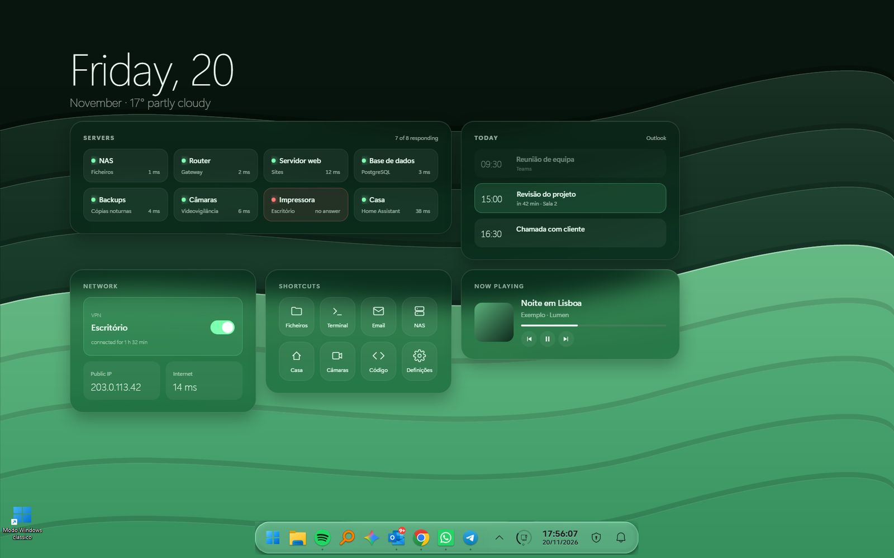

Lumen on the desktop (screenshots use sample data).

---

## Contents

- [Why Lumen](#why-lumen)
- [What's inside](#whats-inside)
- [The wallpaper that counts the hours](#the-wallpaper-that-counts-the-hours)
- [6 themes](#6-themes)
- [The Lumen Panel](#the-lumen-panel)
- [Install](#install)
- [Keyboard shortcuts](#keyboard-shortcuts)
- [Privacy](#privacy)
- [FAQ](#faq)
- [How it's built](#how-its-built)
- [Credits and licence](#credits-and-licence)

---

## Why Lumen

Windows 11 is good, but it looks the same on every PC. Lumen gives it **personality and purpose** without making it heavier or more complicated:

- 🪟 **Beautiful on purpose.** Glass with real refraction and highlights, smooth animations and colours that match each other: bar, wallpaper, panels, cursors and the Panel itself.
- 🧭 **Useful every day.** What you need to see during the day lives on the wallpaper: server status, your next meeting, the VPN, the music. Nothing to open.
- 🔒 **Yours and safe.** Installs **without admin rights**, for your user only (even on a work PC). Uninstall it and Windows is exactly as it was.
- 🎛️ **Fully customizable.** Everything changes in the Lumen Panel, instantly, no restart.
- 🌍 **In Portuguese, English and Spanish.** The bar, the panels, the Panel and the installer.

## What's inside

| | |
|---|---|
| **🪟 Glass bar** | Replaces the taskbar: pinned and running apps, clock with seconds, tray, VPN button, widgets and **its own Start**. The Windows key opens Lumen's Start. Red badges on icons (WhatsApp, Telegram, Outlook…). |
| **🌄 Live wallpaper** | 8 layers that light up from the bottom through your work hours. Others see a nice wallpaper; you know how much is left. It rests on weekends and holidays. |
| **📊 Desktop panels** | They live **on the wallpaper itself, under your icons**. Click empty space to use them. |
| &nbsp;&nbsp;&nbsp;🖥️ Servers | Status and response time (ping, then the port). One click opens **RDP**, **SSH** or the web page. |
| &nbsp;&nbsp;&nbsp;📅 Today | Today's meetings from classic Outlook, with "in 42 min". |
| &nbsp;&nbsp;&nbsp;🔐 Network & VPN | Connect and disconnect Windows VPNs in one click, see for how long, and **get warned when the VPN drops**. Public IP and latency. |
| &nbsp;&nbsp;&nbsp;⚡ Shortcuts | Pages, programs, remote connections: big buttons with the icon you choose. |
| &nbsp;&nbsp;&nbsp;🎵 Now playing | Spotify (or any player) with cover art, progress and controls. |
| **🔔 Only Lumen notifications** | Windows banners are hidden and each notification shows **once**, as a glass card above the bell. |
| **🎨 6 themes** | Emerald, Ocean, Indigo, Amber, Graphite and Glacier (light). They change the wallpaper, the panels and the Panel together, and each has a 4K picture too. |
| **🖱️ Fluent cursors** | Dark or light, tail-less, Windows 11 style. |
| **↩️ Classic Windows mode** | A desktop shortcut puts everything back to stock Windows (taskbar, wallpaper, cursors). Click again and Lumen is back. Handy when lending the PC. |
| **🖧 Remote control** | The bar stays visible in Chrome Remote Desktop, AnyDesk, TeamViewer, RustDesk… |
| **🙈 Hidden Windows taskbar** | Stays hidden for good; `Ctrl` `Alt` `B` shows it when you need it. |
| **⬆️ Automatic updates** | The Panel checks GitHub for new versions and installs them for you. |

## The wallpaper that counts the hours

The wallpaper is a clock in disguise. At 9:00 it's dark; through the day the layers light up, with a thread of light on the current hour's layer; at the end of the day it's fully lit. Work hours (with a lunch break), work days and holidays are set in the Panel.

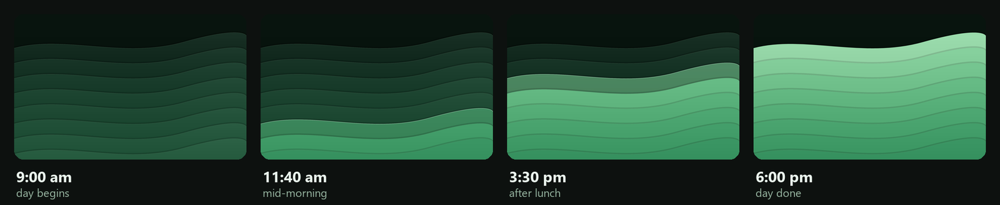

If you prefer, the wallpaper can be just the theme's **4K picture**, or you can keep **your own wallpaper**: Lumen won't touch it.

## 6 themes

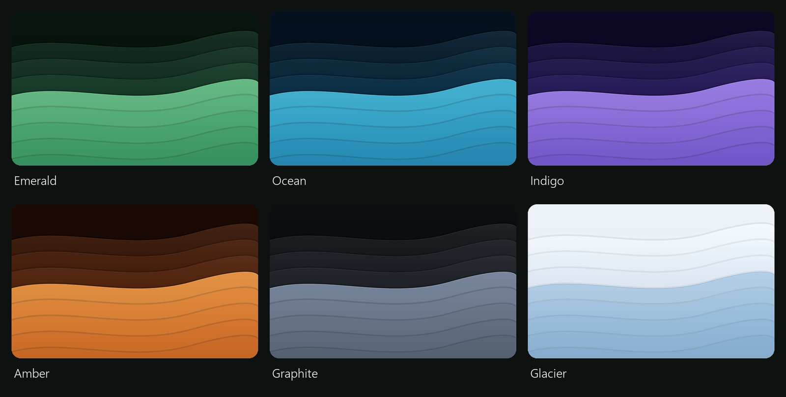

## The Lumen Panel

Everything Lumen does is changed here, with **automatic saving**: there is no "Save" button.

<table>
<tr>
<td width="50%">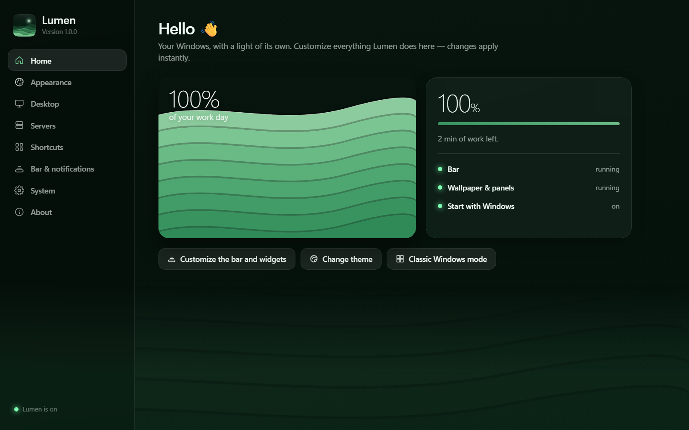 <b>Home</b>: your work day and Lumen's status.</td>
<td width="50%">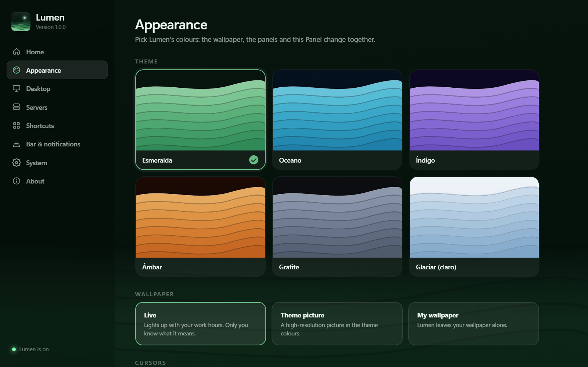 <b>Appearance</b>: theme, wallpaper and cursors.</td>
</tr>
<tr>
<td>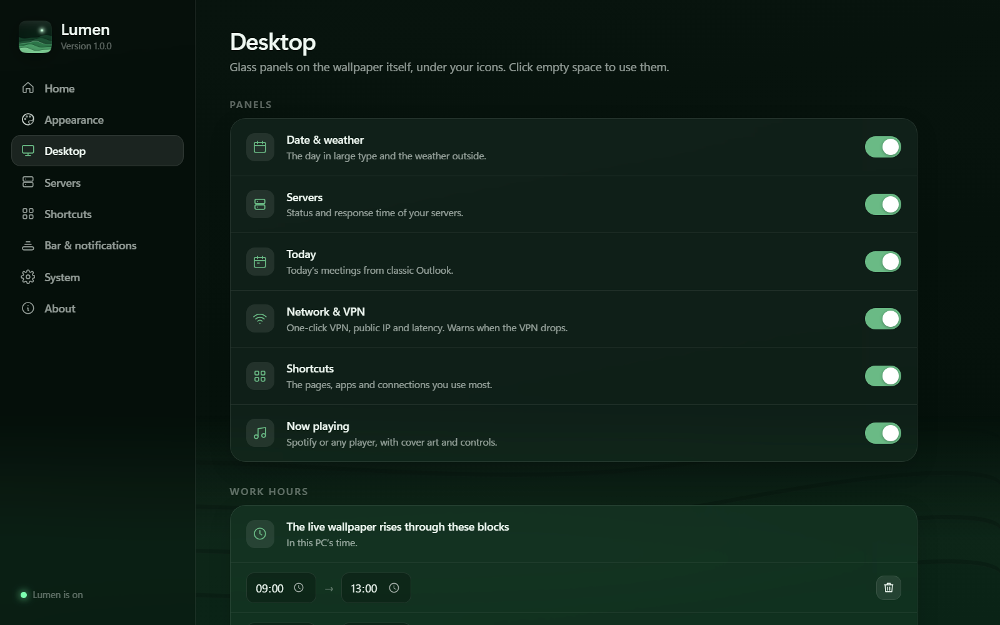 <b>Desktop</b>: each panel, work hours, days and holidays.</td>
<td>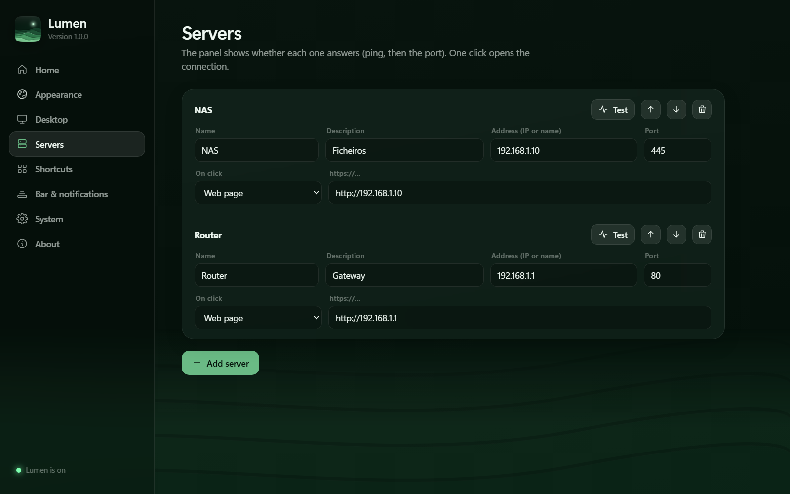 <b>Servers</b>: with a button to test each one.</td>
</tr>
<tr>
<td>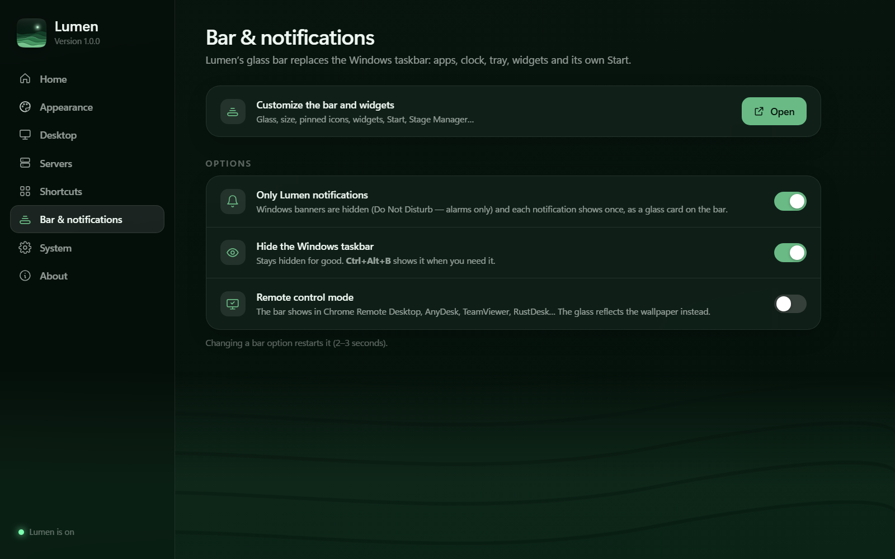 <b>Bar & notifications</b>: plus the bar's full settings.</td>
<td>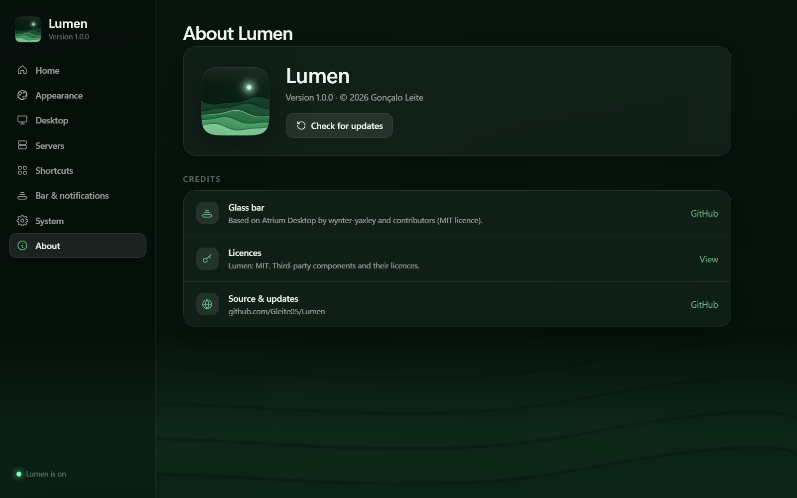 <b>About</b>: version, updates and credits.</td>
</tr>
</table>

The bar also has its **full settings** (opened from the Panel): glass material (refraction, dispersion, highlight, transparency), shape and size, pinned icons, Start, tray, clock, widgets, Stage Manager, displays and language.

## Install

1. Download the latest **[Lumen-Setup](https://github.com/Gleite05/Lumen/releases/latest)** (≈ 100 MB).
2. Run it and pick the **language**, **theme** and **cursors**.
3. Done: the bar, wallpaper and panels show up right away. To customize, open **Lumen** from the Start menu.

> [!NOTE]
> The installer isn't code-signed yet, so Windows may show **"Windows protected your PC"**. Click **More info → Run anyway**.

**Requirements:** Windows 11 or Windows 10 (version 2004 or newer), 64-bit, and the **Microsoft Edge WebView2 Runtime** (included in Windows 11; the installer tells you if it's missing).

**Update:** the Panel tells you when there's a new version (*About → Check for updates*). You can also just install the new version on top: your settings stay.

**Uninstall:** *Settings → Apps → Lumen*. The Windows taskbar, wallpaper and cursors go back to how they were. Your settings stay in `%LOCALAPPDATA%\Lumen` in case you come back (delete that folder if you don't want them).

**Already using Atrium Desktop?** Lumen takes over your bar settings.

## Keyboard shortcuts

| Keys | What |
|---|---|
| `⊞ Win` | Opens Lumen's Start |
| `Ctrl` `Alt` `B` | Shows (or hides again) the Windows taskbar |
| Double-click the Lumen icon | Opens the Panel |

## Privacy

Lumen has **no account, no ads and sends none of your data** anywhere. The only internet contacts are:

| What for | Service |
|---|---|
| Public IP on the Network panel | `api.ipify.org` |
| Weather (widget and date) | Open-Meteo, with an approximate location from your IP (`ipapi.co` / `ipwho.is` / BigDataCloud) |
| Checking for updates | GitHub API (this repository) |

The servers you add are tested **from your PC** (ping and port), and the calendar is read from the Outlook you already have open. None of it leaves your PC. Settings live in `%LOCALAPPDATA%\Lumen\lumen.json`, a text file you can also edit by hand: Lumen applies changes instantly.

## FAQ

<b>Does it slow the PC down?</b>

Not noticeably. The bar is native (C++ and Direct3D) and runs at 60 fps; the live wallpaper redraws every 5 minutes; the panels refresh every 30 seconds.

<b>Can I use it on my work PC?</b>

Yes: it installs without admin rights, in your account only. If company policy blocks per-user programs, ask whoever manages the PCs.

<b>Do desktop icons stay on top of the panels?</b>

Yes. The panels live on the wallpaper itself, under the icons. Clicks on empty space go to the panels; clicks on an icon belong to the icon.

<b>How do I go back to normal Windows for a while?</b>

Use the **Classic Windows mode** desktop shortcut (or *Panel → System*). To come back, the same shortcut becomes **Back to Lumen**.

<b>My wallpaper went back to Windows' / the bar doesn't show.</b>

Open **Lumen** from the Start menu → *System → Restart Lumen*. If it persists, logs are in `%LOCALAPPDATA%\Lumen\logs`: open an issue with them.

<b>Does it work with several monitors?</b>

The bar can show on the main display or on all of them (bar settings → <i>Displays</i>). The live wallpaper and the panels stay on the main display.

## How it's built

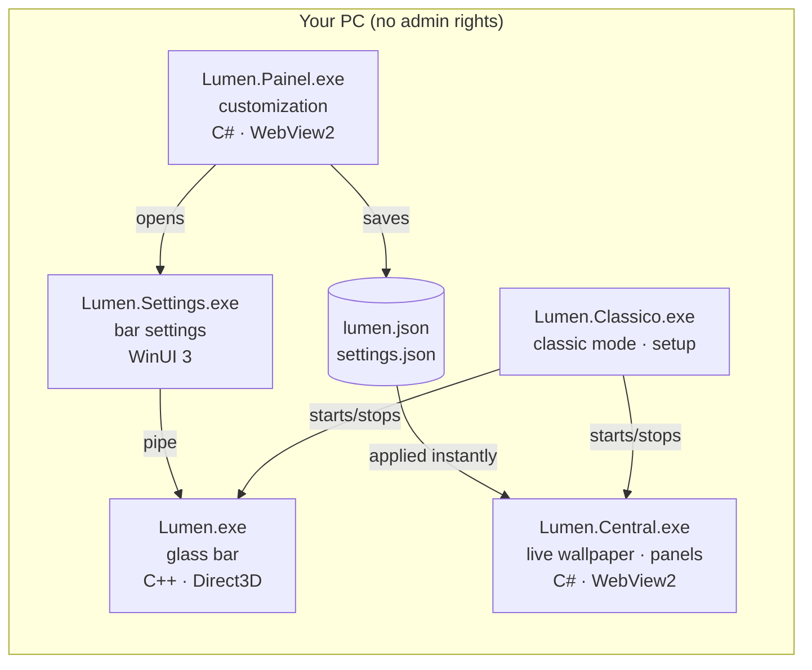

| Folder | What |
|---|---|
| [`central/`](central/) | **Lumen Central**: live wallpaper, panels under the icons, hidden Windows taskbar, startup guard. |
| [`painel/`](painel/) | **Lumen Panel**: the customization app (the page also runs in a browser, in demo mode). |
| [`classico/`](classico/) | **Classic Windows mode**, first-run setup and restoring Windows on uninstall. |
| [`comum/`](comum/) | Folders, settings, languages, themes and what touches Windows. |
| [`barra/`](barra/) | The bar's default settings and the script that brands it as Lumen at build time. |
| [`atrium-desktop/`](https://github.com/Gleite05/atrium-desktop/tree/vpn) | The bar engine (fork of Atrium Desktop, with VPN, music and PT/ES translations), updated weekly. |
| [`instalador/`](instalador/) | Inno Setup: the PT/EN/ES installer. |
| [`marca/`](marca/) · [`fundos/`](fundos/) · [`cursores/`](cursores/) | Logo, 4K wallpapers and cursors, with their Python generators. |

**Build:** GitHub Actions builds everything and the installer on every change ([`lumen.yml`](.github/workflows/lumen.yml)). A `vX.Y.Z` tag publishes a release. Locally, `compilar.ps1` builds Central, Panel and Classic with the .NET Framework that ships with Windows: no Visual Studio needed.

## Credits and licence

The glass bar is based on **[Atrium Desktop](https://github.com/wynter-yaxley/atrium-desktop)** by wynter-yaxley and contributors (MIT licence). Thank you! Other components in [THIRD-PARTY-NOTICES.md](THIRD-PARTY-NOTICES.md).

**Lumen © 2026 Gonçalo Leite** — [MIT](LICENSE) licence. Not affiliated with Microsoft or Apple; "Windows" is a trademark of Microsoft.

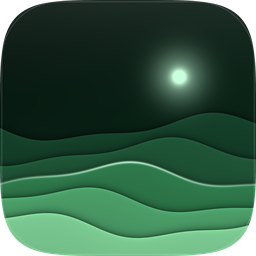 Made with light in Portugal.

