
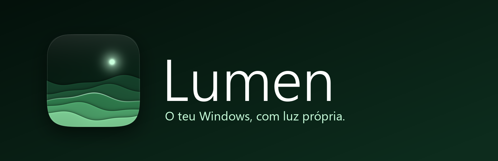

  
  
  
  
  

  <a href="README.md">Português</a> · <a href="README.en.md">English</a> · <b>Español</b>

<h3 align="center">Una barra de cristal, un fondo que cuenta las horas y paneles útiles en el propio escritorio. Lo instalas, eliges un tema y tu PC se convierte en otro. Con un clic vuelves al Windows de siempre.</h3>

  

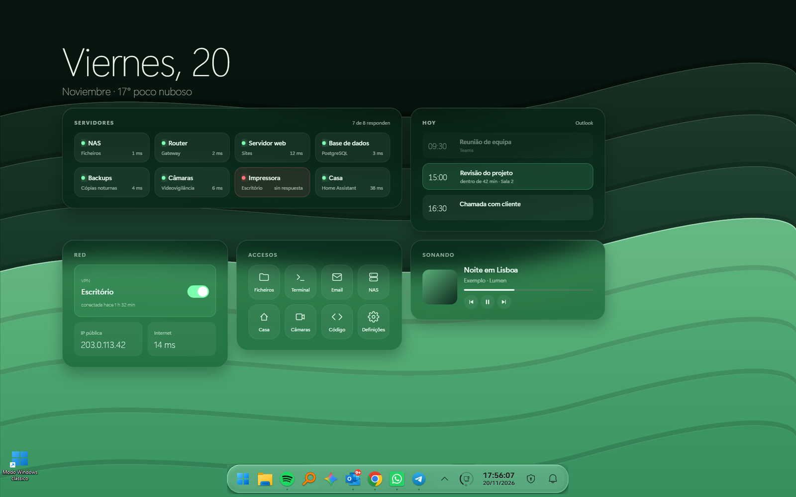

Lumen en el escritorio (capturas con datos de ejemplo).

---

## Índice

- [Por qué Lumen](#por-qué-lumen)
- [Qué trae](#qué-trae)
- [El fondo que cuenta las horas](#el-fondo-que-cuenta-las-horas)
- [6 temas](#6-temas)
- [El Panel de Lumen](#el-panel-de-lumen)
- [Instalar](#instalar)
- [Atajos de teclado](#atajos-de-teclado)
- [Privacidad](#privacidad)
- [Preguntas frecuentes](#preguntas-frecuentes)
- [Cómo está hecho](#cómo-está-hecho)
- [Créditos y licencia](#créditos-y-licencia)

---

## Por qué Lumen

Windows 11 está bien, pero es igual en todos los PC. Lumen le da **personalidad y utilidad** sin hacerlo más pesado ni más complicado:

- 🪟 **Bonito a propósito.** Cristal con refracción y brillo reales, animaciones suaves y colores que combinan entre sí: barra, fondo, paneles, cursores y el propio Panel.
- 🧭 **Útil todos los días.** Lo que necesitas ver durante el día está en el fondo: el estado de los servidores, la próxima reunión, la VPN, la música. Sin abrir nada.
- 🔒 **Tuyo y seguro.** Se instala **sin permisos de administrador**, solo para tu usuario (incluso en un PC de empresa). Lo desinstalas y Windows queda exactamente como estaba.
- 🎛️ **Totalmente personalizable.** Todo se cambia en el Panel de Lumen, al instante, sin reiniciar.
- 🌍 **En portugués, inglés y español.** La barra, los paneles, el Panel y el instalador.

## Qué trae

| | |
|---|---|
| **🪟 Barra de cristal** | Sustituye la barra de tareas: apps ancladas y abiertas, reloj con segundos, área de notificación, botón de VPN, widgets y un **Inicio propio**. La tecla Windows abre el Inicio de Lumen. Contadores rojos en los iconos (WhatsApp, Telegram, Outlook…). |
| **🌄 Fondo vivo** | 8 capas que se iluminan de abajo arriba a lo largo de tu horario de trabajo. Quien mira ve un fondo bonito; tú sabes cuánto falta. Descansa los fines de semana y festivos. |
| **📊 Paneles en el escritorio** | Están **en el propio fondo, bajo los iconos**. Pulsa en el espacio vacío para usarlos. |
| &nbsp;&nbsp;&nbsp;🖥️ Servidores | Estado y tiempo de respuesta (ping; si no responde, prueba el puerto). Un clic abre el **RDP**, el **SSH** o la página. |
| &nbsp;&nbsp;&nbsp;📅 Hoy | Las reuniones del día en Outlook clásico, con «dentro de 42 min». |
| &nbsp;&nbsp;&nbsp;🔐 Red y VPN | Conecta y desconecta las VPN de Windows con un clic, muestra cuánto tiempo llevas conectado y **avisa si la VPN se cae**. IP pública y latencia. |
| &nbsp;&nbsp;&nbsp;⚡ Accesos | Páginas, programas, conexiones remotas: botones grandes con el icono que elijas. |
| &nbsp;&nbsp;&nbsp;🎵 Sonando | Spotify (u otro reproductor) con carátula, progreso y controles. |
| **🔔 Solo las notificaciones de Lumen** | Los avisos de Windows se ocultan y cada notificación aparece **una vez**, en una tarjeta de cristal sobre la campana. |
| **🎨 6 temas** | Esmeralda, Océano, Índigo, Ámbar, Grafito y Glaciar (claro). Cambian el fondo, los paneles y el Panel a la vez, y cada uno tiene también una imagen 4K. |
| **🖱️ Cursores Fluent** | Oscuros o claros, sin cola, al estilo de Windows 11. |
| **↩️ Modo Windows clásico** | Un acceso en el escritorio devuelve todo al Windows de origen (barra, fondo, cursores). Otro clic y Lumen vuelve. Útil para prestar el PC. |
| **🖧 Control remoto** | La barra sigue visible en Chrome Remote Desktop, AnyDesk, TeamViewer, RustDesk… |
| **🙈 Barra de Windows oculta** | Se queda oculta; `Ctrl` `Alt` `B` la muestra cuando la necesites. |
| **⬆️ Actualizaciones automáticas** | El Panel busca versiones nuevas en GitHub y las instala solo. |

## El fondo que cuenta las horas

El fondo es un reloj disfrazado. A las 9:00 está oscuro; a lo largo del día las capas se iluminan, con un hilo de luz en la capa de la hora actual; al final del día está todo iluminado. El horario (con pausa para comer), los días de trabajo y los festivos se eligen en el Panel.

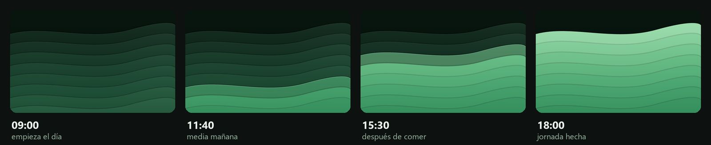

Si lo prefieres, el fondo puede ser solo la **imagen 4K del tema**, o puedes mantener **tu fondo**: Lumen no lo toca.

## 6 temas

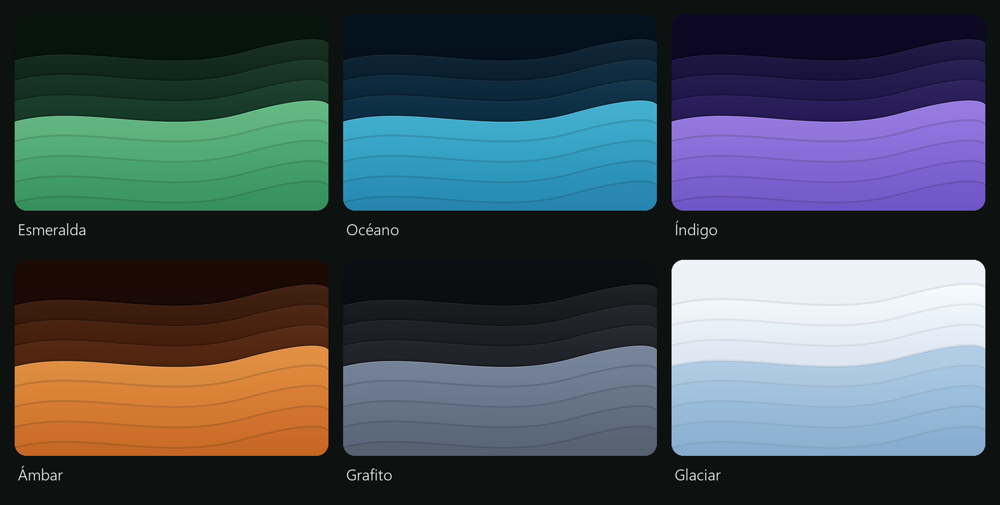

## El Panel de Lumen

Todo lo que hace Lumen se cambia aquí, con **guardado automático**: no hay botón «Guardar».

<table>
<tr>
<td width="50%">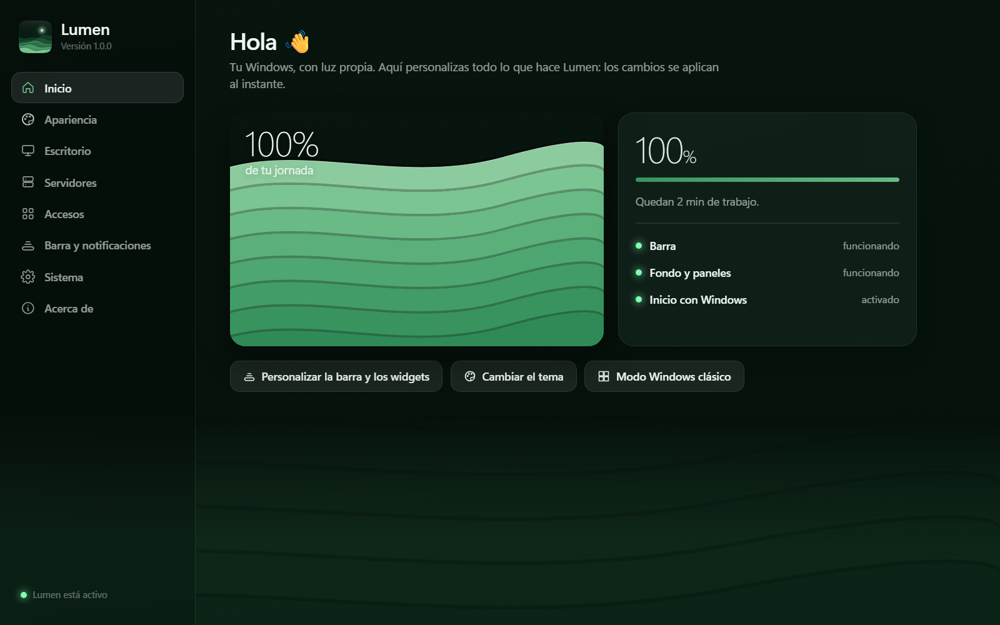 <b>Inicio</b>: tu jornada y el estado de Lumen.</td>
<td width="50%">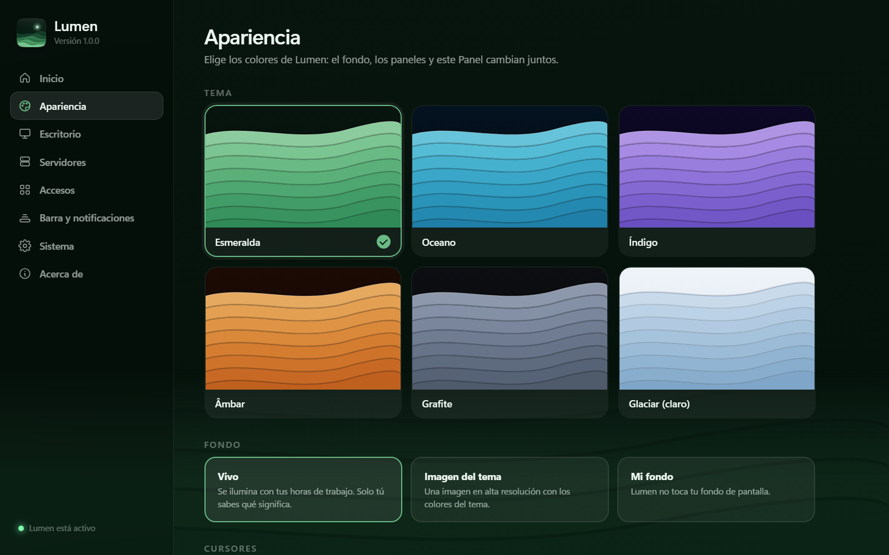 <b>Apariencia</b>: tema, fondo y cursores.</td>
</tr>
<tr>
<td>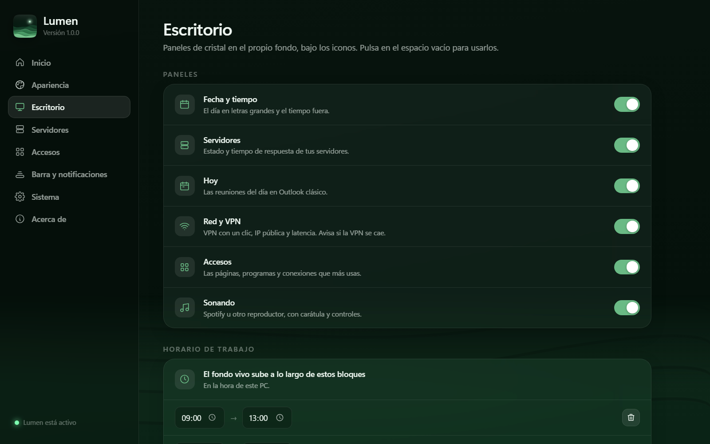 <b>Escritorio</b>: cada panel, horario, días y festivos.</td>
<td>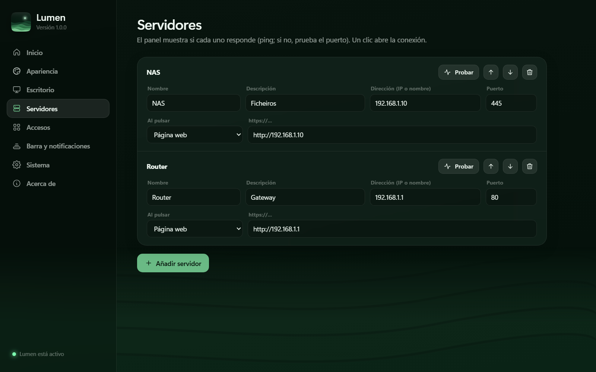 <b>Servidores</b>: con un botón para probar cada uno.</td>
</tr>
<tr>
<td>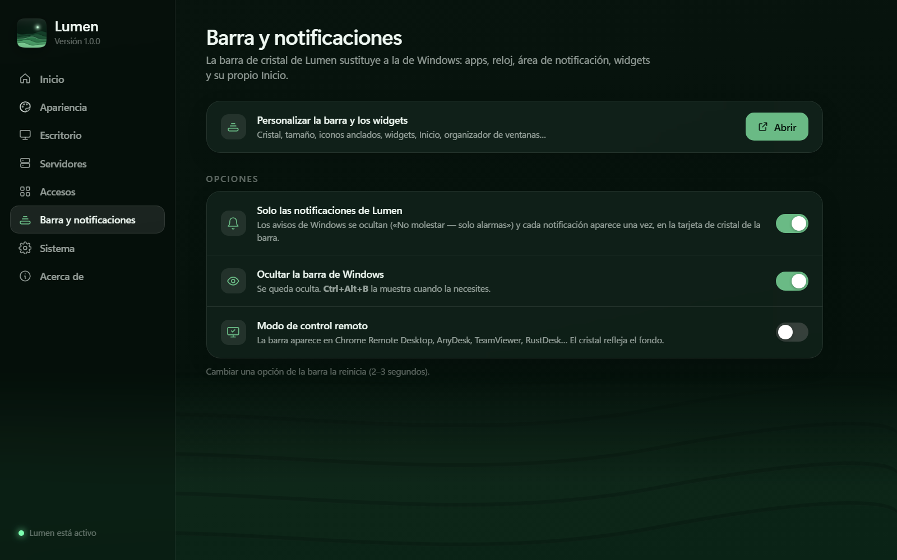 <b>Barra y notificaciones</b>: y acceso a la configuración completa de la barra.</td>
<td>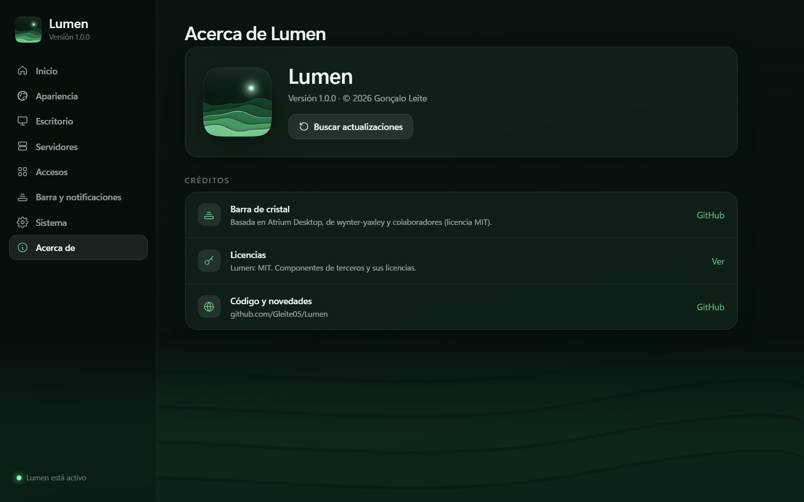 <b>Acerca de</b>: versión, actualizaciones y créditos.</td>
</tr>
</table>

La barra tiene además su **configuración completa** (se abre desde el Panel): material del cristal (refracción, dispersión, brillo, transparencia), forma y tamaño, iconos anclados, Inicio, área de notificación, reloj, widgets, organizador de ventanas, pantallas e idioma.

## Instalar

1. Descarga el último **[Lumen-Setup](https://github.com/Gleite05/Lumen/releases/latest)** (≈ 100 MB).
2. Ábrelo y elige el **idioma**, el **tema** y los **cursores**.
3. Listo: la barra, el fondo y los paneles aparecen al momento. Para personalizar, abre **Lumen** en el menú Inicio.

> [!NOTE]
> El instalador aún no está firmado, así que Windows puede mostrar **«Windows protegió su PC»**. Pulsa **Más información → Ejecutar de todas formas**.

**Requisitos:** Windows 11 o Windows 10 (versión 2004 o posterior), 64 bits, y **Microsoft Edge WebView2 Runtime** (viene con Windows 11; el instalador avisa si falta).

**Actualizar:** el Panel avisa cuando hay una versión nueva (*Acerca de → Buscar actualizaciones*). También puedes instalar la versión nueva encima: lo que configuraste se queda.

**Desinstalar:** *Configuración → Aplicaciones → Lumen*. La barra de Windows, el fondo y los cursores vuelven a lo que eran. Tu configuración queda en `%LOCALAPPDATA%\Lumen` por si vuelves (borra esa carpeta si no la quieres).

**¿Ya usabas Atrium Desktop?** Lumen se queda con la configuración de tu barra.

## Atajos de teclado

| Teclas | Qué hace |
|---|---|
| `⊞ Win` | Abre el Inicio de Lumen |
| `Ctrl` `Alt` `B` | Muestra (u oculta de nuevo) la barra de Windows |
| Doble clic en el icono de Lumen | Abre el Panel |

## Privacidad

Lumen **no tiene cuenta, no tiene anuncios y no envía tus datos** a ningún sitio. Los únicos contactos con internet son:

| Para qué | Servicio |
|---|---|
| IP pública en el panel Red | `api.ipify.org` |
| El tiempo (widget y fecha) | Open-Meteo, con la ubicación aproximada por la IP (`ipapi.co` / `ipwho.is` / BigDataCloud) |
| Buscar actualizaciones | API de GitHub (este repositorio) |

Los servidores que añades se prueban **desde tu PC** (ping y puerto), y la agenda se lee del Outlook que ya tienes abierto. Nada de eso sale del PC. La configuración vive en `%LOCALAPPDATA%\Lumen\lumen.json`, un archivo de texto que también puedes editar a mano: Lumen aplica los cambios al instante.

## Preguntas frecuentes

<b>¿Hace el PC más lento?</b>

No se nota. La barra es nativa (C++ y Direct3D) y va a 60 fps; el fondo vivo solo se redibuja cada 5 minutos; los paneles se actualizan cada 30 segundos.

<b>¿Puedo usarlo en el PC del trabajo?</b>

Sí: se instala sin permisos de administrador, solo en tu cuenta. Si la política de la empresa no permite programas instalados por usuarios, habla con quien gestiona los PC.

<b>¿Los iconos del escritorio quedan por encima de los paneles?</b>

Sí. Los paneles están en el propio fondo, bajo los iconos. Los clics en el espacio vacío van a los paneles; los clics en un icono son del icono.

<b>¿Cómo vuelvo al Windows normal un rato?</b>

Usa el acceso **Modo Windows clásico** del escritorio (o *Panel → Sistema*). Para volver, el mismo acceso pasa a llamarse **Volver a Lumen**.

<b>Mi fondo volvió al de Windows / la barra no aparece.</b>

Abre **Lumen** en el menú Inicio → *Sistema → Reiniciar Lumen*. Si sigue, los registros están en `%LOCALAPPDATA%\Lumen\logs`: abre un <i>issue</i> con ellos.

<b>¿Funciona con varios monitores?</b>

La barra puede aparecer en la pantalla principal o en todas (configuración de la barra → <i>Pantallas</i>). El fondo vivo y los paneles quedan en la pantalla principal.

## Cómo está hecho

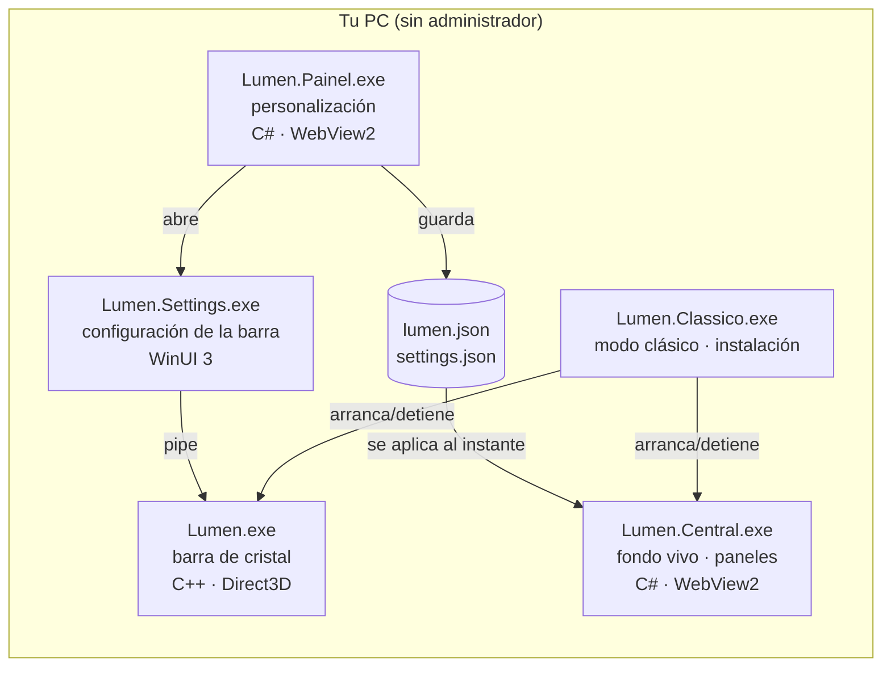

| Carpeta | Qué es |
|---|---|
| [`central/`](central/) | **Lumen Central**: fondo vivo, paneles bajo los iconos, barra de Windows oculta, guardia de arranque. |
| [`painel/`](painel/) | **Panel de Lumen**: la app de personalización (la página también funciona en un navegador, en modo demostración). |
| [`classico/`](classico/) | **Modo Windows clásico**, primera configuración tras instalar y restauración de Windows al desinstalar. |
| [`comum/`](comum/) | Carpetas, configuración, idiomas, temas y lo que toca Windows. |
| [`barra/`](barra/) | Configuración de origen de la barra y el script que le pone la marca Lumen al compilar. |
| [`atrium-desktop/`](https://github.com/Gleite05/atrium-desktop/tree/vpn) | El motor de la barra (fork de Atrium Desktop, con VPN, música y traducciones PT/ES), actualizado cada semana. |
| [`instalador/`](instalador/) | Inno Setup: el instalador en PT/EN/ES. |
| [`marca/`](marca/) · [`fundos/`](fundos/) · [`cursores/`](cursores/) | Logotipo, fondos 4K y cursores, con los generadores en Python. |

**Compilar:** GitHub Actions compila todo y genera el instalador en cada cambio ([`lumen.yml`](.github/workflows/lumen.yml)). Una etiqueta `vX.Y.Z` publica la versión. En local, `compilar.ps1` compila Central, Panel y Clásico solo con el .NET Framework que ya trae Windows: no hace falta Visual Studio.

## Créditos y licencia

La barra de cristal se basa en **[Atrium Desktop](https://github.com/wynter-yaxley/atrium-desktop)**, de wynter-yaxley y colaboradores (licencia MIT). ¡Gracias! Otros componentes en [THIRD-PARTY-NOTICES.md](THIRD-PARTY-NOTICES.md).

**Lumen © 2026 Gonçalo Leite** — licencia [MIT](LICENSE). No está afiliado a Microsoft ni a Apple; «Windows» es una marca de Microsoft.

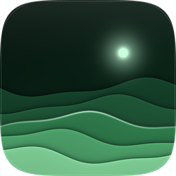 Hecho con luz en Portugal.

