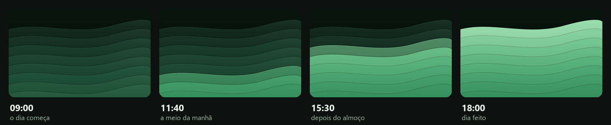
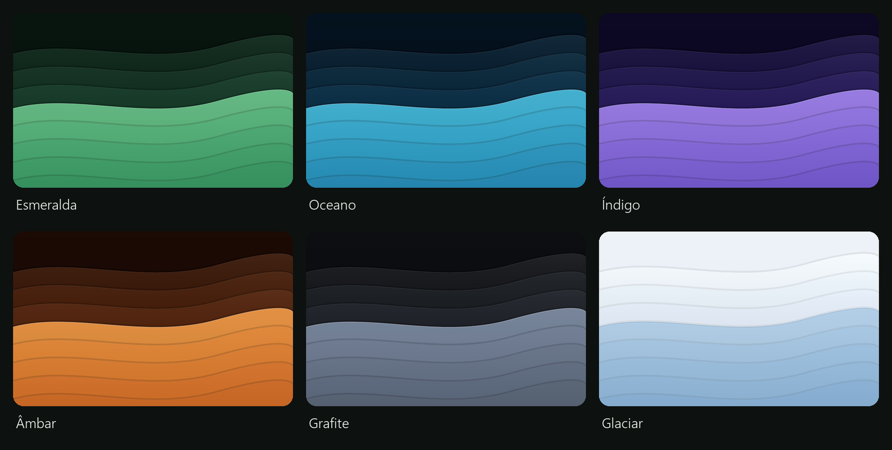
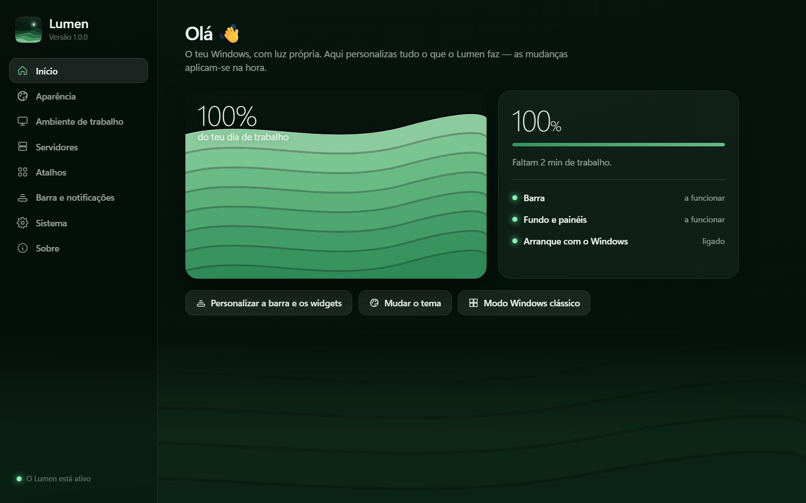
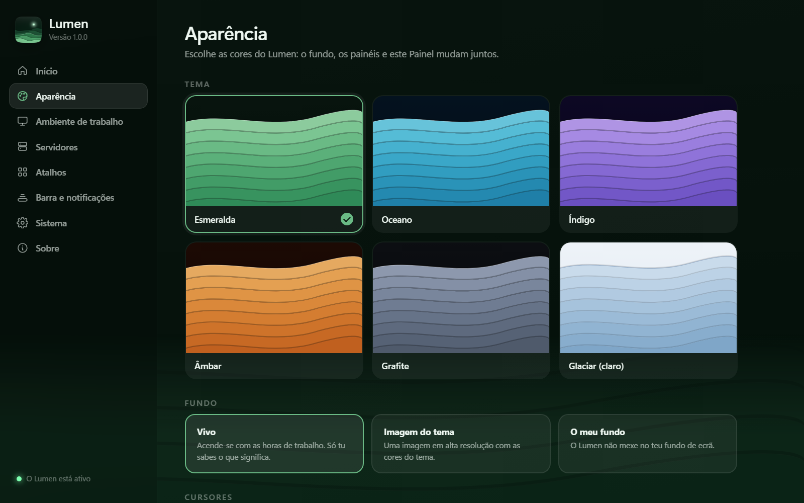
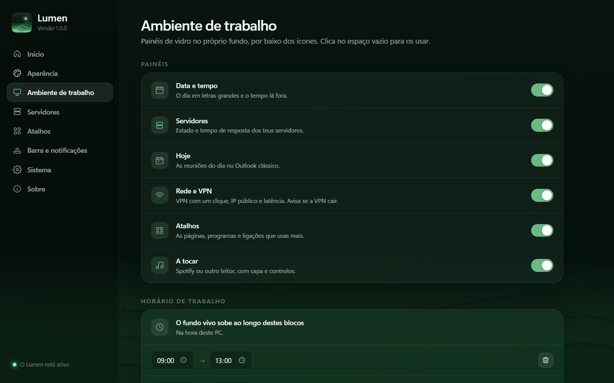
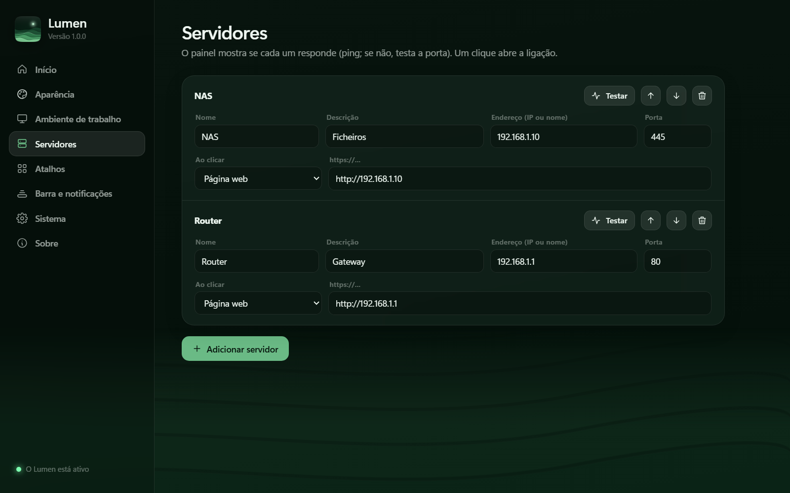
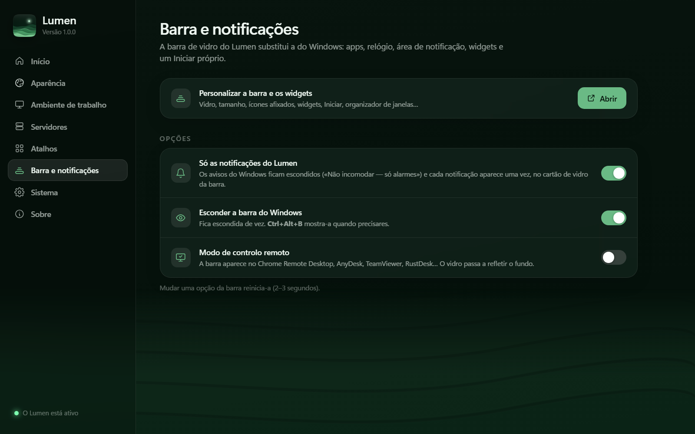
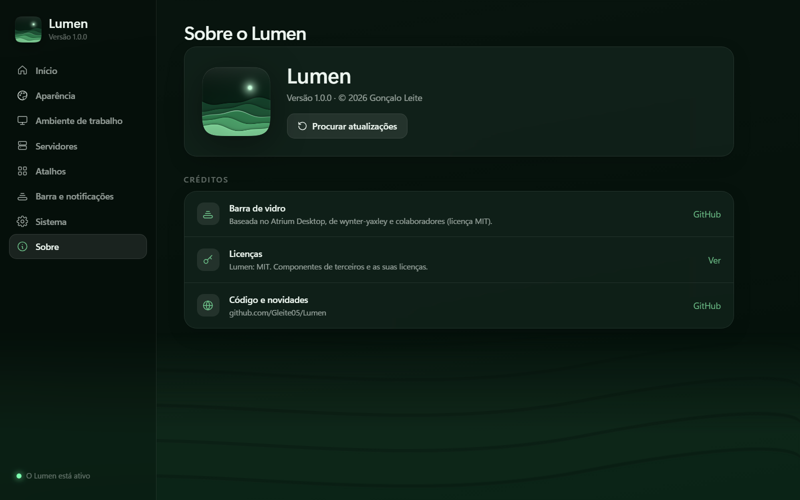
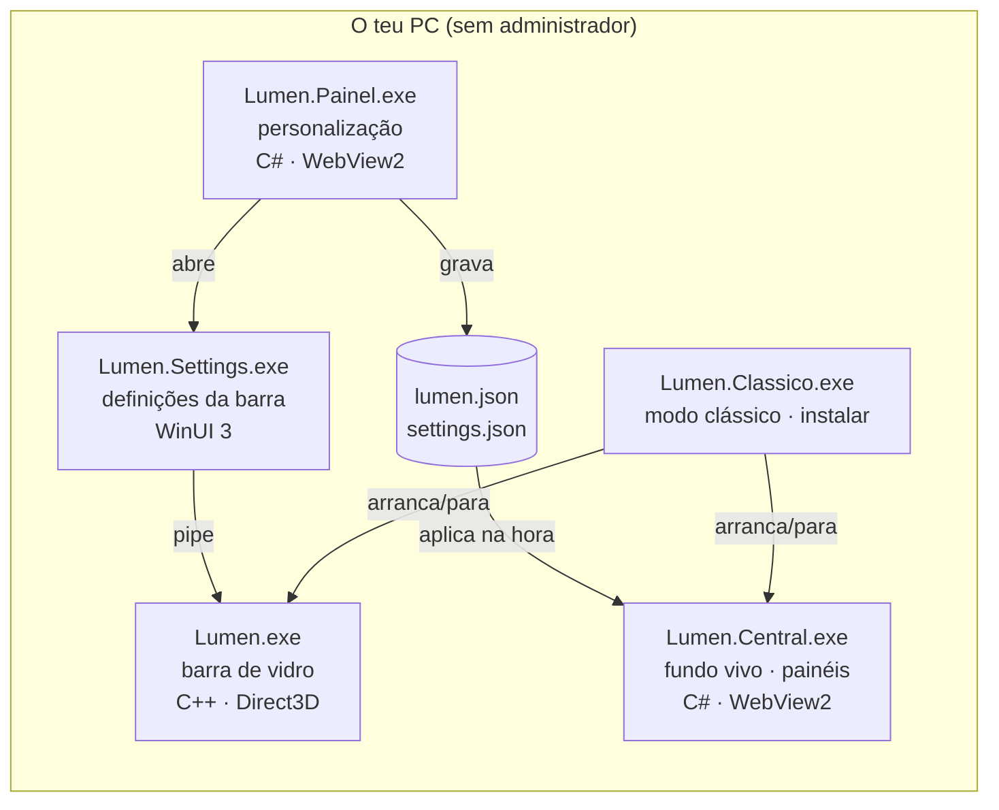

  
  
  
  
  

  <b>Português</b> · <a href="README.en.md">English</a> · <a href="README.es.md">Español</a>

<h3 align="center">Uma barra de vidro, um fundo que conta as horas e painéis úteis no próprio ambiente de trabalho. Instalas, escolhes um tema, e o teu PC fica outro. Um clique e voltas ao Windows de sempre.</h3>

  

O Lumen tal como fica no ambiente de trabalho (capturas com dados de exemplo).

---

## Índice

- [Porquê o Lumen](#porquê-o-lumen)
- [O que traz](#o-que-traz)
- [O fundo que conta as horas](#o-fundo-que-conta-as-horas)
- [6 temas](#6-temas)
- [O Painel do Lumen](#o-painel-do-lumen)
- [Instalar](#instalar)
- [Atalhos de teclado](#atalhos-de-teclado)
- [Privacidade](#privacidade)
- [Perguntas frequentes](#perguntas-frequentes)
- [Como é feito](#como-é-feito)
- [Créditos e licença](#créditos-e-licença)

---

## Porquê o Lumen

O Windows 11 é bom, mas é igual em todos os PCs. O Lumen dá-lhe **personalidade e utilidade** sem o tornar mais pesado nem mais complicado:

- 🪟 **Bonito de propósito.** Vidro com refração e brilho reais, animações suaves e cores que combinam entre si: barra, fundo, painéis, cursores e o próprio Painel.
- 🧭 **Útil todos os dias.** O que precisas de ver ao longo do dia fica no fundo: o estado dos servidores, a próxima reunião, a VPN, a música. Sem abrir nada.
- 🔒 **Teu e seguro.** Instala-se **sem direitos de administrador**, só para o teu utilizador (até num PC de empresa). Desinstala-se e o Windows fica exatamente como estava.
- 🎛️ **Totalmente personalizável.** Tudo se muda no Painel do Lumen, e as mudanças aplicam-se na hora, sem reiniciar.
- 🌍 **Em português, inglês e espanhol.** A barra, os painéis, o Painel e o instalador.

## O que traz

| | |
|---|---|
| **🪟 Barra de vidro** | Substitui a barra de tarefas: apps afixadas e abertas, relógio com segundos, área de notificação, botão de VPN, widgets e um **Iniciar próprio**. A tecla Windows abre o Iniciar do Lumen. Contadores vermelhos nos ícones (WhatsApp, Telegram, Outlook…). |
| **🌄 Fundo vivo** | 8 camadas que se acendem de baixo para cima ao longo do teu horário de trabalho. Quem olha vê um fundo bonito; tu sabes quanto falta. Descansa nos fins de semana e feriados. |
| **📊 Painéis no ambiente de trabalho** | Ficam **no próprio fundo, por baixo dos ícones**. Clica no espaço vazio para os usar. |
| &nbsp;&nbsp;&nbsp;🖥️ Servidores | Estado e tempo de resposta (ping; se não responder, testa a porta). Um clique abre o **RDP**, o **SSH** ou a página. |
| &nbsp;&nbsp;&nbsp;📅 Hoje | As reuniões do dia no Outlook clássico, com «daqui a 42 min». |
| &nbsp;&nbsp;&nbsp;🔐 Rede e VPN | Liga e desliga as VPNs do Windows com um clique, mostra há quanto tempo estás ligado e **avisa se a VPN cair**. IP público e latência. |
| &nbsp;&nbsp;&nbsp;⚡ Atalhos | Páginas, programas, ligações remotas: botões grandes, com ícone à escolha. |
| &nbsp;&nbsp;&nbsp;🎵 A tocar | Spotify (ou outro leitor) com capa, progresso e controlos. |
| **🔔 Só as notificações do Lumen** | Os avisos do Windows ficam escondidos e cada notificação aparece **uma vez**, num cartão de vidro por cima do sino. |
| **🎨 6 temas** | Esmeralda, Oceano, Índigo, Âmbar, Grafite e Glaciar (claro). Mudam o fundo, os painéis e o Painel ao mesmo tempo. Cada um tem também uma imagem 4K. |
| **🖱️ Cursores Fluent** | Escuros ou claros, sem cauda, ao estilo do Windows 11. |
| **↩️ Modo Windows clássico** | Um atalho no ambiente de trabalho devolve tudo ao Windows de origem (barra, fundo, cursores). Outro clique e o Lumen volta. Útil para emprestar o PC. |
| **🖧 Controlo remoto** | A barra continua visível no Chrome Remote Desktop, AnyDesk, TeamViewer, RustDesk… |
| **🙈 Barra do Windows escondida** | Fica escondida de vez; `Ctrl` `Alt` `B` mostra-a quando precisares. |
| **⬆️ Atualizações automáticas** | O Painel procura versões novas no GitHub e instala-as sozinho. |

## O fundo que conta as horas

O fundo é um relógio disfarçado. Às 9:00 está escuro; ao longo do dia as camadas acendem-se, com um fio de luz na camada da hora em curso; no fim do dia está todo aceso. O horário (com intervalo de almoço), os dias de trabalho e os feriados escolhem-se no Painel.

Se preferires, o fundo pode ser só a **imagem 4K do tema**, ou podes manter **o teu fundo**: o Lumen não lhe toca.

## 6 temas

## O Painel do Lumen

Tudo o que o Lumen faz muda-se aqui, com **gravação automática**: não há botão «Guardar».

<table>
<tr>
<td width="50%"> <b>Início</b> — o teu dia de trabalho e o estado do Lumen.</td>
<td width="50%"> <b>Aparência</b> — tema, fundo e cursores.</td>
</tr>
<tr>
<td> <b>Ambiente de trabalho</b> — cada painel, horário, dias e feriados.</td>
<td> <b>Servidores</b> — com botão para testar cada um.</td>
</tr>
<tr>
<td> <b>Barra e notificações</b> — e acesso às definições completas da barra.</td>
<td> <b>Sobre</b> — versão, atualizações e créditos.</td>
</tr>
</table>

A barra tem ainda as suas **definições completas** (abertas a partir do Painel): material do vidro (refração, dispersão, brilho, transparência), forma e tamanho, ícones afixados, Iniciar, área de notificação, relógio, widgets, organizador de janelas («Gestor de palco»), ecrãs e idioma.

## Instalar

1. Descarrega o **[Lumen-Setup](https://github.com/Gleite05/Lumen/releases/latest)** mais recente (≈ 100 MB).
2. Abre-o e escolhe o **idioma**, o **tema** e os **cursores**.
3. Pronto: a barra, o fundo e os painéis aparecem logo. Para personalizar, abre **Lumen** no menu Iniciar.

> [!NOTE]
> O instalador ainda não tem assinatura digital, por isso o Windows pode mostrar **«O Windows protegeu o computador»**. Carrega em **Mais informações → Executar mesmo assim**.

**Requisitos:** Windows 11 ou Windows 10 (versão 2004 ou mais recente), 64 bits, e o **Microsoft Edge WebView2 Runtime** (já vem com o Windows 11; o instalador avisa se faltar).

**Atualizar:** o Painel avisa quando há uma versão nova (*Sobre → Procurar atualizações*). Também podes simplesmente instalar a versão nova por cima: o que configuraste fica.

**Desinstalar:** *Definições → Aplicações → Lumen*. A barra do Windows, o fundo e os cursores voltam ao que eram. As tuas definições ficam em `%LOCALAPPDATA%\Lumen`, para quando voltares (apaga essa pasta se não quiseres).

**Quem já usava o Atrium Desktop** fica com as definições da barra que tinha: o Lumen trata da mudança.

## Atalhos de teclado

| Teclas | O quê |
|---|---|
| `⊞ Win` | Abre o Iniciar do Lumen |
| `Ctrl` `Alt` `B` | Mostra (ou volta a esconder) a barra do Windows |
| Duplo clique no ícone do Lumen | Abre o Painel |

## Privacidade

O Lumen **não tem conta, não tem anúncios e não envia dados teus** para lado nenhum. Os únicos contactos com a internet são:

| Para quê | Serviço |
|---|---|
| IP público no painel Rede | `api.ipify.org` |
| Previsão do tempo (widget e data) | Open-Meteo, com a localização aproximada pelo IP (`ipapi.co` / `ipwho.is` / BigDataCloud) |
| Procurar atualizações | API do GitHub (este repositório) |

Os servidores que acrescentas são testados **a partir do teu PC** (ping e porta), e a agenda é lida do Outlook que já tens aberto. Nada disso sai do PC. As definições vivem em `%LOCALAPPDATA%\Lumen\lumen.json`, um ficheiro de texto que também podes editar à mão: o Lumen aplica as mudanças na hora.

## Perguntas frequentes

<b>Deixa o PC mais lento?</b>

Não se nota. A barra é nativa (C++ e Direct3D) e desenha a 60 fps; o fundo vivo só é redesenhado de 5 em 5 minutos; os painéis atualizam-se de 30 em 30 segundos.

<b>Posso usar no PC do trabalho?</b>

Sim: instala-se sem direitos de administrador, só na tua conta. Se a política da empresa não permitir programas instalados por utilizadores, fala com quem gere os PCs.

<b>Os ícones do ambiente de trabalho ficam por cima dos painéis?</b>

Sim. Os painéis vivem no próprio fundo, por baixo dos ícones. Os cliques no espaço vazio vão para os painéis; os cliques num ícone são só do ícone.

<b>Como volto ao Windows normal por um bocado?</b>

Usa o atalho **Modo Windows clássico** no ambiente de trabalho (ou *Painel → Sistema*). Para voltar, o mesmo atalho passa a chamar-se **Voltar ao Lumen**.

<b>O meu fundo voltou ao do Windows / a barra não aparece.</b>

Abre **Lumen** no menu Iniciar → *Sistema → Reiniciar o Lumen*. Se continuar, os registos estão em `%LOCALAPPDATA%\Lumen\logs`: abre um <i>issue</i> com eles.

<b>Funciona com vários monitores?</b>

A barra pode aparecer no ecrã principal ou em todos (definições da barra → <i>Ecrãs</i>). O fundo vivo e os painéis ficam no ecrã principal.

## Como é feito

| Pasta | O quê |
|---|---|
| [`central/`](central/) | **Lumen Central**: fundo vivo, painéis por baixo dos ícones, barra do Windows escondida, guarda de arranque. |
| [`painel/`](painel/) | **Painel do Lumen**: a app de personalização (a página funciona também num browser, em modo de demonstração). |
| [`classico/`](classico/) | **Modo Windows clássico**, primeira configuração depois de instalar e reposição do Windows ao desinstalar. |
| [`comum/`](comum/) | Pastas, configuração, idiomas, temas e o que mexe no Windows. |
| [`barra/`](barra/) | Definições de origem da barra e o script que lhe dá a marca Lumen na compilação. |
| [`atrium-desktop/`](https://github.com/Gleite05/atrium-desktop/tree/vpn) | O motor da barra (fork do Atrium Desktop, com VPN, música e traduções PT/ES), atualizado todas as semanas. |
| [`instalador/`](instalador/) | Inno Setup: o instalador em PT/EN/ES. |
| [`marca/`](marca/) · [`fundos/`](fundos/) · [`cursores/`](cursores/) | Logótipo, fundos 4K e cursores, com os geradores em Python. |

**Compilar:** o GitHub Actions compila tudo e faz o instalador em cada alteração ([`lumen.yml`](.github/workflows/lumen.yml)). Uma etiqueta `vX.Y.Z` publica a versão. Localmente, `compilar.ps1` compila o Central, o Painel e o Clássico só com o .NET Framework que já vem com o Windows: não é preciso Visual Studio.

## Créditos e licença

A barra de vidro é baseada no **[Atrium Desktop](https://github.com/wynter-yaxley/atrium-desktop)**, de wynter-yaxley e colaboradores (licença MIT). Obrigado! Outros componentes em [THIRD-PARTY-NOTICES.md](THIRD-PARTY-NOTICES.md).

**Lumen © 2026 Gonçalo Leite** — licença [MIT](LICENSE). Não é afiliado à Microsoft nem à Apple; «Windows» é uma marca da Microsoft.

 Feito com luz em Portugal.

