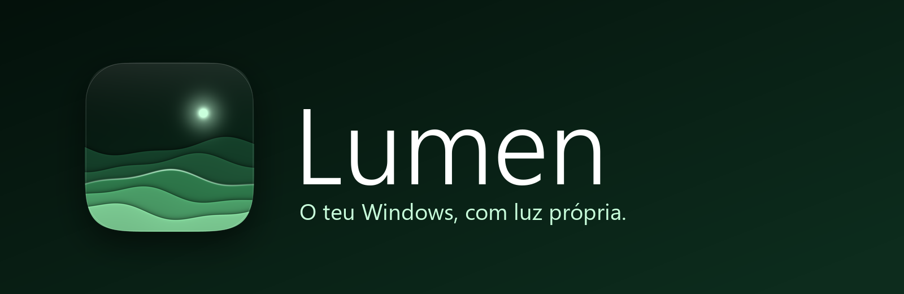
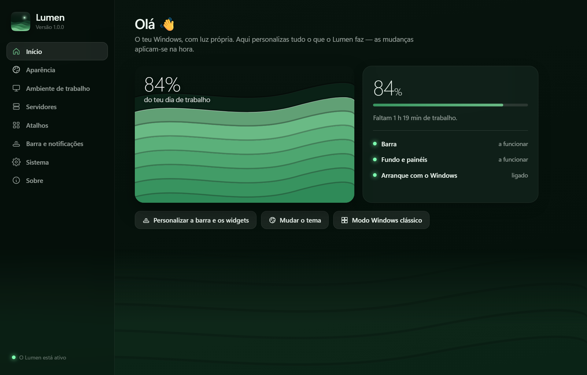
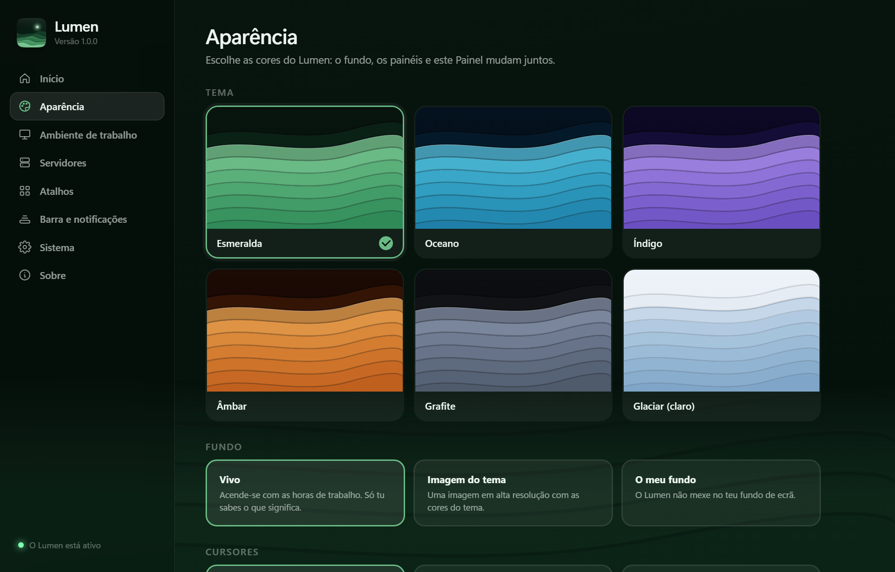

  <a href="https://github.com/Gleite05/Lumen/releases/latest"><b>⬇ Descarregar o Lumen</b></a> ·
  <a href="#english">English</a> ·
  <a href="#español">Español</a>

**O Lumen transforma o Windows 11 (e 10) num ambiente de trabalho de vidro, vivo e teu.** Instalas, escolhes um tema e o PC muda: uma barra de vidro no lugar da barra de tarefas, um fundo que conta as horas do teu dia de trabalho e painéis úteis no próprio ambiente de trabalho. E com um clique voltas ao Windows de sempre.

- **Sem direitos de administrador**: instala-se só para o teu utilizador (até num PC de empresa).
- **Totalmente personalizável** no **Painel do Lumen**: tema, fundo, cursores, painéis, horário, servidores, atalhos, notificações, idioma.
- **Em português, inglês e espanhol.**

## O que traz

| | |
|---|---|
| **Barra de vidro** | Apps, relógio, área de notificação, VPN, widgets (tempo, sistema, música…) e um Iniciar próprio. A tecla Windows abre o Iniciar do Lumen. |
| **Fundo vivo** | 8 camadas que se acendem de baixo para cima ao longo do teu horário de trabalho. Quem olha vê um fundo bonito; tu sabes quanto falta. |
| **Painéis no ambiente de trabalho** | Por baixo dos ícones: servidores (ping/porta e RDP/SSH com um clique), reuniões do dia (Outlook), VPN com aviso quando cai, IP público, atalhos e o que está a tocar. |
| **Só as notificações do Lumen** | Os avisos do Windows ficam escondidos e cada notificação aparece uma vez, num cartão de vidro. |
| **6 temas** | Esmeralda, Oceano, Índigo, Âmbar, Grafite e Glaciar (claro), com fundos 4K a condizer. |
| **Cursores Fluent** | Escuros ou claros, sem cauda, ao estilo do Windows 11. |
| **Modo Windows clássico** | Um atalho no ambiente de trabalho devolve tudo ao Windows de origem; outro clique e o Lumen volta. |
| **Controlo remoto** | A barra aparece no Chrome Remote Desktop, AnyDesk, TeamViewer, RustDesk… |
| **Atualizações** | O Painel procura versões novas e instala-as sozinho. |

## Instalar

1. Descarrega o **[Lumen-Setup](https://github.com/Gleite05/Lumen/releases/latest)** mais recente.
2. Abre-o, escolhe o idioma, o tema e os cursores. Pronto.

> O instalador ainda não tem assinatura digital: o Windows pode mostrar «O Windows protegeu o computador». Carrega em **Mais informações → Executar mesmo assim**.

Precisa do **Microsoft Edge WebView2 Runtime** (já vem com o Windows 11).

**Desinstalar**: *Definições → Aplicações → Lumen*. O Windows volta a ficar como era (barra, fundo, cursores); as tuas definições ficam em `%LOCALAPPDATA%\Lumen` para quando voltares.

## Personalizar

Abre **Lumen** no menu Iniciar (ou faz duplo clique no ícone do Lumen junto ao relógio):

- **Aparência**: tema, fundo (vivo, imagem do tema ou o teu) e cursores.
- **Ambiente de trabalho**: liga e desliga cada painel; horário, dias de trabalho e feriados.
- **Servidores** e **Atalhos**: o que aparece nos painéis.
- **Barra e notificações**: abre as definições completas da barra (vidro, tamanho, widgets, Iniciar…).
- **Sistema**: idioma, arranque com o Windows, modo clássico.

Tudo fica em `%LOCALAPPDATA%\Lumen\lumen.json` (também se pode editar à mão: o Lumen aplica as mudanças na hora).

## Como é feito

| Pasta | O quê |
|---|---|
| [`central/`](central/) | **Lumen Central** (C# + WebView2): fundo vivo, painéis por baixo dos ícones, barra do Windows escondida (`Ctrl+Alt+B` mostra-a). |
| [`painel/`](painel/) | **Painel do Lumen**: a app de personalização. |
| [`classico/`](classico/) | **Modo Windows clássico**, primeira configuração e reposição do Windows ao desinstalar. |
| [`comum/`](comum/) | Pastas, configuração, idiomas, temas e o que mexe no Windows. |
| [`barra/`](barra/) | Definições de origem da barra e o script que lhe dá a marca Lumen na compilação. |
| [`atrium-desktop/`](https://github.com/Gleite05/atrium-desktop/tree/vpn) | O motor da barra (fork do Atrium Desktop, ramo `vpn`), atualizado todas as semanas. |
| [`instalador/`](instalador/) | Inno Setup: o instalador em PT/EN/ES. |
| [`marca/`](marca/), [`fundos/`](fundos/), [`cursores/`](cursores/) | Logótipo, fundos 4K e cursores, com os geradores em Python. |

Compilar: o GitHub Actions faz tudo (`.github/workflows/lumen.yml`). Uma etiqueta `vX.Y.Z` publica a release com o instalador. Localmente, `compilar.ps1` compila as peças próprias só com o .NET Framework que vem com o Windows.

## Créditos

A barra de vidro é baseada no **[Atrium Desktop](https://github.com/wynter-yaxley/atrium-desktop)**, de wynter-yaxley e colaboradores (licença MIT). Ver [THIRD-PARTY-NOTICES.md](THIRD-PARTY-NOTICES.md).

Lumen © 2026 Gonçalo Leite — [MIT](LICENSE). Não é afiliado à Microsoft nem à Apple.

---

## English

**Lumen turns Windows 11 (and 10) into a living glass desktop that is yours.** Install it, pick a theme and your PC changes: a glass bar replaces the taskbar, the wallpaper quietly counts the hours of your work day, and useful panels live on the desktop itself. One click takes you back to plain Windows.

- **No admin rights** — installs for your user only (even on a work PC).
- **Fully customizable** in the **Lumen Panel**: theme, wallpaper, cursors, panels, work hours, servers, shortcuts, notifications, language.
- Glass bar with widgets and its own Start · live wallpaper · desktop panels (servers, Outlook meetings, VPN, shortcuts, music) · only Lumen's notifications · 6 themes · Fluent cursors · classic Windows mode · remote-control friendly · automatic updates.

**Install:** download the latest **[Lumen-Setup](https://github.com/Gleite05/Lumen/releases/latest)**, run it, choose language, theme and cursors. The installer isn't code-signed yet, so Windows may show "Windows protected your PC" — click **More info → Run anyway**. Requires the Microsoft Edge WebView2 Runtime (included in Windows 11). Uninstall from *Settings → Apps → Lumen*; Windows goes back to how it was.

The glass bar is based on [Atrium Desktop](https://github.com/wynter-yaxley/atrium-desktop) by wynter-yaxley and contributors (MIT). Lumen © 2026 Gonçalo Leite — MIT.

## Español

**Lumen convierte Windows 11 (y 10) en un escritorio de cristal, vivo y tuyo.** Lo instalas, eliges un tema y el PC cambia: una barra de cristal en lugar de la barra de tareas, un fondo que cuenta las horas de tu jornada y paneles útiles en el propio escritorio. Con un clic vuelves al Windows de siempre.

- **Sin permisos de administrador**: se instala solo para tu usuario (incluso en un PC de empresa).
- **Totalmente personalizable** en el **Panel de Lumen**: tema, fondo, cursores, paneles, horario, servidores, accesos, notificaciones, idioma.
- Barra de cristal con widgets e Inicio propio · fondo vivo · paneles en el escritorio (servidores, reuniones de Outlook, VPN, accesos, música) · solo las notificaciones de Lumen · 6 temas · cursores Fluent · modo Windows clásico · compatible con control remoto · actualizaciones automáticas.

**Instalar:** descarga el último **[Lumen-Setup](https://github.com/Gleite05/Lumen/releases/latest)**, ábrelo y elige idioma, tema y cursores. El instalador aún no está firmado: Windows puede mostrar «Windows protegió su PC» — pulsa **Más información → Ejecutar de todas formas**. Necesita Microsoft Edge WebView2 Runtime (viene con Windows 11). Se desinstala en *Configuración → Aplicaciones → Lumen*; Windows vuelve a quedar como estaba.

La barra de cristal se basa en [Atrium Desktop](https://github.com/wynter-yaxley/atrium-desktop), de wynter-yaxley y colaboradores (MIT). Lumen © 2026 Gonçalo Leite — MIT.
