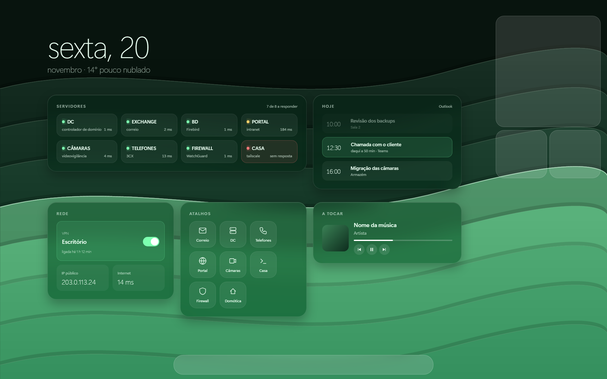
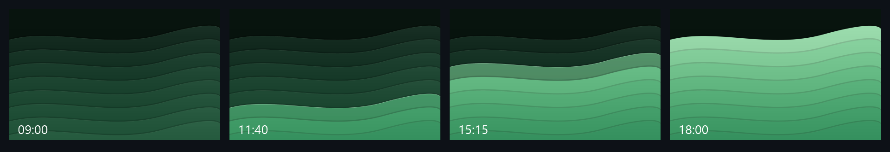

# Windows 2.0

O meu Windows 11 com outra cara: uma barra de vidro ao estilo macOS no lugar da barra de tarefas, a VPN à distância de um clique, um widget do Spotify, contadores de mensagens nos ícones, fundos vetoriais próprios e cursores sem cauda.

Tudo corre **sem direitos de administrador**, numa conta normal (até num PC de domínio).



O fundo é um relógio disfarçado: as camadas acendem-se ao longo do horário de trabalho.



<sub>Capturas com dados de exemplo.</sub>

---

## O que está cá dentro

| Pasta | O que é |
|---|---|
| [`atrium-desktop/`](https://github.com/Gleite05/atrium-desktop/tree/vpn) | A barra **Atrium** modificada (submódulo → fork `Gleite05/atrium-desktop`, ramo `vpn`). |
| [`atrium/`](atrium/) | As minhas definições do Atrium (vidro, tamanhos, widgets à direita…). |
| [`central/`](central/) | **Central**: o fundo de ecrã vira central de controlo — as camadas acendem-se com as horas de trabalho (só tu sabes) e por cima há painéis de servidores, agenda do Outlook, VPN, atalhos e música. Também guarda as definições do Atrium. |
| [`barra-oculta/`](barra-oculta/) | **BarraOculta**: esconde de vez a barra do Windows; `Ctrl+Alt+B` mostra-a. |
| [`fundos/`](fundos/) | 6 fundos vetoriais 3840×2400 (Esmeralda, Oceano, Glaciar, Índigo, Âmbar, Grafite) e o gerador em Python. |
| [`cursores/`](cursores/) | Cursores **Fluent Escuro** e **Fluent Claro** (seta sem cauda, estilo Windows 11) e o gerador. |
| [`ajustes/`](ajustes/) | Ajustes do registo (desligar a intermitência da barra do Windows). |
| [`vpn-painel/`](vpn-painel/) | Versão antiga da VPN (ícone + painel à parte). Ficou como alternativa; a VPN agora vive dentro do Atrium. |
| [`instalar.ps1`](instalar.ps1) | Instala tudo de uma vez. |

### O que o Atrium modificado traz a mais

- **Botão VPN na barra**, à esquerda do sino, com o desenho do Atrium. Fica com um ponto verde quando há uma VPN ligada. Clicar abre uma página no centro de controlo com todas as VPNs do Windows para ligar/desligar (usa `rasdial`; se faltarem credenciais abre a janela do Windows).
- **Widget do Spotify** (ou de qualquer leitor): capa do álbum, música, artista, progresso e botões anterior / play / seguinte.
- **Contadores vermelhos nos ícones** das apps: mensagens do WhatsApp, Telegram, Outlook… (conta as notificações desde a última vez que abriste a app, ou o “(N)” no título da janela).
- **Clicar numa notificação abre a app** (antes podia fechá-la).
- **Tecla Windows abre o Iniciar do Atrium.**
- **Arranca depois do Explorer** ao iniciar sessão — sem isto o Windows podia saltar os programas de arranque e o fundo de ecrã.

---

## Instalar

1. Instala o **Atrium 2.7.0 oficial**: <https://github.com/wynter-yaxley/atrium-desktop/releases>
2. Clona este repositório e corre o instalador:

```powershell
git clone --recurse-submodules https://github.com/Gleite05/Windows-2.0
cd Windows-2.0
powershell -ExecutionPolicy Bypass -File .\instalar.ps1
```

O instalador:
- troca o `Atrium.exe` pela versão modificada (descarregada das [Releases](https://github.com/Gleite05/Windows-2.0/releases); guarda o original como `Atrium-original.exe`);
- copia as definições do Atrium (faz cópia das tuas antes);
- compila e põe a arrancar a **BarraOculta** (usa o `csc` do .NET Framework que já vem com o Windows);
- compila e põe a arrancar o **Central** (descarrega o WebView2 do NuGet); o fundo passa a ser dele;
- desliga a intermitência da barra do Windows;
- instala os cursores **Fluent Escuro** e o fundo **Esmeralda**;
- põe 15 s de atraso na tarefa de arranque do Atrium.

Opções: `-SemCentral` (e então `-Fundo oceano`, `glaciar`, `indigo`, `ambar` ou `grafite` escolhe um fundo fixo), `-Cursores claro`, `-SemDefinicoes` (não mexe nas definições do Atrium), `-SemCursores`, `-SemFundo`.

### Atalhos

| Teclas | O quê |
|---|---|
| `Win` | Iniciar do Atrium |
| `Ctrl+Alt+B` | Mostra a barra original do Windows (e esconde outra vez) |

---

## Compilar o Atrium modificado

O código está no submódulo [`atrium-desktop`](https://github.com/Gleite05/atrium-desktop/tree/vpn). Compila sozinho no GitHub Actions (workflow `fork-build.yml`, artefacto `Atrium-exe`) — não é preciso Visual Studio no PC.

Localmente: Visual Studio 2022 + CMake, `cmake --preset win-x64` e `cmake --build`.

## Gerar fundos e cursores

```powershell
pip install numpy pillow scipy
python fundos\gerador-wallpaper.py render esmeralda 3840 2400 esmeralda.png
python cursores\gerador-cursores.py build fluent-escuro .\Fluent-Escuro
```

---

## Créditos

- **Atrium Desktop** © wynter-yaxley — licença MIT. Este projeto usa um fork com alterações próprias; a licença original mantém-se no fork.
- Tudo o resto (BarraOculta, VpnPainel, fundos, cursores, instalador) é meu, licença MIT.
