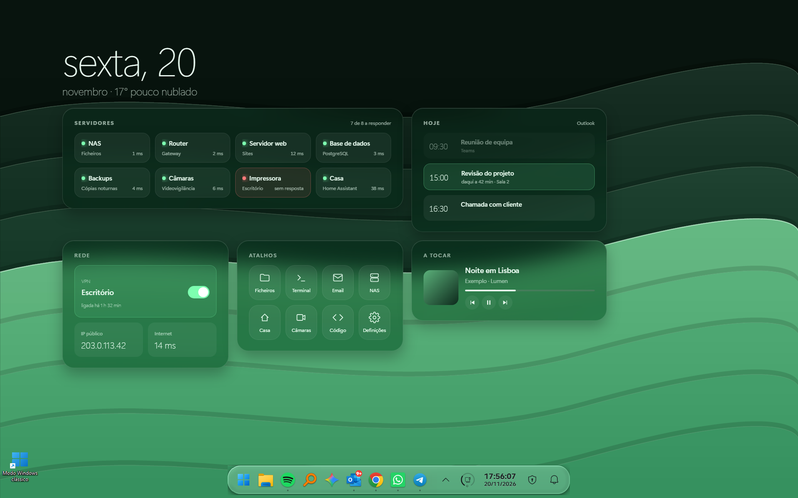
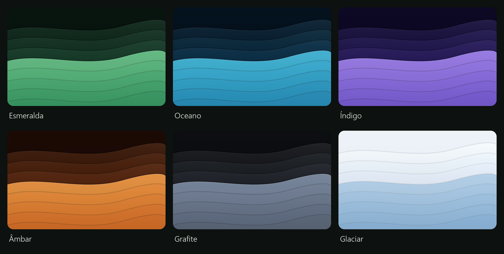

**A primeira versão do Lumen.** / **The first Lumen release.** / **La primera versión de Lumen.**

- Barra de vidro com widgets, VPN e Iniciar próprio (PT/EN/ES).
- Fundo vivo que conta as horas do dia de trabalho, em 6 temas.
- Painéis no ambiente de trabalho: servidores, reuniões do Outlook, rede/VPN, atalhos e música.
- Painel do Lumen para personalizar tudo; atualizações automáticas.
- Só as notificações do Lumen; cursores Fluent; modo Windows clássico; modo de controlo remoto.

> Há uma versão mais recente: usa a [última](https://github.com/Gleite05/Lumen/releases/latest).
