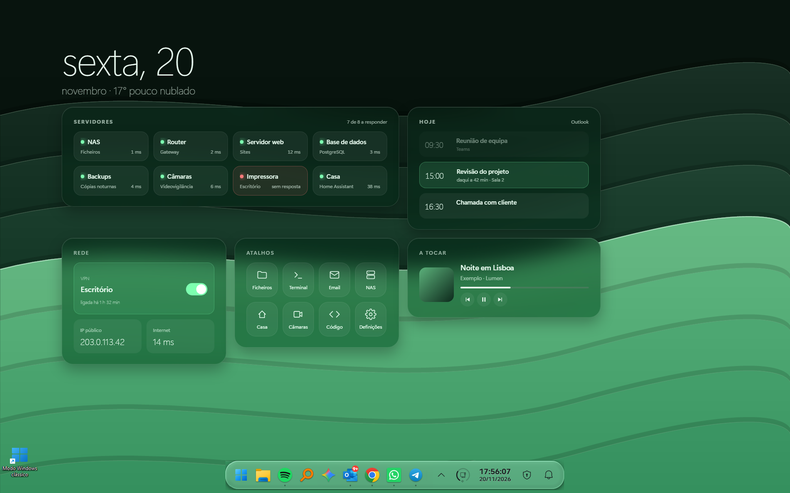

### Correções · Fixes · Correcciones

- **Definições da barra em português e espanhol.** Na 1.0.0 apareciam em inglês: uma frase repetida nas traduções fazia a app rejeitar o ficheiro.
  *Bar settings now in Portuguese and Spanish (1.0.0 showed English).* · *La configuración de la barra ya aparece en portugués y español.*
- **O fundo vivo e os painéis arrancam sempre** e voltam sozinhos se o Explorer recriar o fundo do ambiente de trabalho.
  *The live wallpaper and panels always start, and come back on their own if Explorer recreates the desktop.* · *El fondo vivo y los paneles arrancan siempre y vuelven solos si el Explorador recrea el escritorio.*
- Pequenos acertos no Painel. · *Small Panel fixes.* · *Pequeños ajustes en el Panel.*

### Instalar · Install · Instalar

⬇ **Lumen-Setup-1.0.1.exe**: sem direitos de administrador. Quem já tem o Lumen pode atualizar no Painel (*Sobre → Procurar atualizações*).
O instalador ainda não tem assinatura digital: se o Windows avisar, *Mais informações → Executar mesmo assim*.

[Português](https://github.com/Gleite05/Lumen#readme) · [English](https://github.com/Gleite05/Lumen/blob/main/README.en.md) · [Español](https://github.com/Gleite05/Lumen/blob/main/README.es.md)
